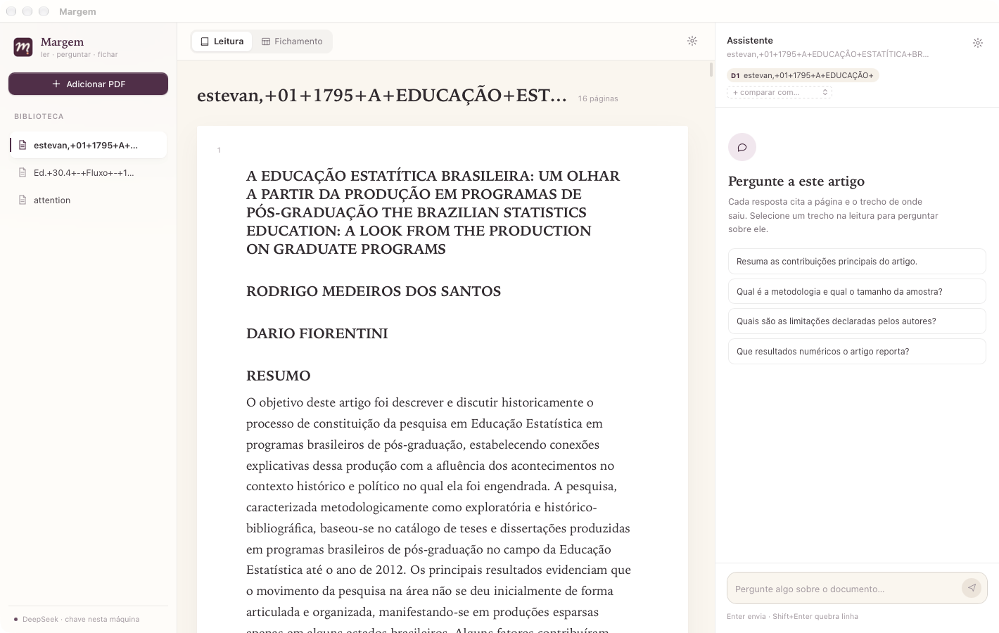

# Margem

Leitor de PDF acadêmico com chat que cita página e trecho, e quadro de fichamento preenchido por colunas. App desktop em **Tauri 2** (Rust + React), local-first, com a API da DeepSeek.



A pergunta nasce na margem: você lê o artigo, anota uma dúvida ao lado do parágrafo e a resposta volta apontando de onde saiu. Clicar em `p. 7` abre o PDF na página e destaca exatamente as linhas citadas.


## O que faz

- **Importa PDF** e converte em leitura Markdown, com âncoras por página.
- **Conversa com o documento**; cada afirmação vem com `[D1 p.7]`. Clicar na citação abre a página do PDF com o trecho destacado.
- **Seleciona um trecho** na leitura e pergunta sobre ele.
- **Compara documentos**: outro PDF entra no escopo do chat (D1, D2…) e a pergunta pode comparar os dois.
- **Fichamento**: você define as colunas (nome + instrução). A IA preenche cada célula com valor, trecho literal e página; sem trecho verificado a célula fica "não encontrado". Exporta CSV.
- **Chave da DeepSeek no SQLite local**, nunca em arquivo de configuração do projeto.

## Como funciona

1. **Extração** (`src/pdf.js`): o pdf.js entrega os itens de texto com posição e tamanho de fonte. O app agrupa em linhas, detecta colunas, remonta parágrafos, reconstrui tabelas em Markdown e guarda, por página, os blocos (para o leitor) e as linhas com o retângulo no espaço do PDF.
2. **Contexto** (`src-tauri/src/ai.rs`): a pergunta escolhe as páginas por raridade de termo (IDF), o documento vai com marcadores `[p. 7]` e a resposta é instruída a citar página e trecho literal.
3. **Citação** (`src-tauri/src/evidence.rs`): `resolve_evidence` acha a menor sequência contígua de linhas que contém o trecho e devolve um retângulo por linha. O modal abre o PDF no zoom escolhido e desenha o destaque pela matriz do viewport — sobrevive a zoom, rotação e redimensionamento.

## Instalar e rodar

Pré-requisitos: Node 20+, Rust 1.77+ e, no macOS, Xcode Command Line Tools.

```sh
npm install
npm run app
```

Na primeira execução, abra **Configurações** (engrenagem) e cole a chave da DeepSeek. Também é possível usar `DEEPSEEK_API_KEY`.

Modelo padrão: `deepseek-flash`. A base URL e o modelo são configuráveis, então qualquer endpoint compatível com OpenAI funciona.

Build de produção:

```sh
npm run tauri build
```

## Custo por pergunta

A pergunta não manda o artigo inteiro. O app escolhe as páginas por peso de termo (um termo raro, como "sobrenome" ou "BLEU", vale mais que "artigo", que aparece em todas), sempre inclui a página 1 e a página seguinte das duas melhores, e para no teto de 18 mil caracteres — cerca de 4 a 5 mil tokens. Antes isso tudo ia junto e dava 11 a 12 mil tokens por pergunta.

A extração do fichamento é a exceção: precisa ver o documento todo para achar números, então vai inteira (uma vez, quando você clica em Extrair).

O histórico volta só com as últimas seis mensagens, para uma resposta longa antiga não ser reenviada a cada pergunta. O cache de contexto da DeepSeek funciona enquanto o começo do prompt não muda.

## Onde ficam os dados

- Banco: `~/Library/Application Support/br.com.gerlan.pdfchat/pdfchat.sqlite3`
- PDFs: `.../uploads/`
- Figuras recortadas: `.../figures/<doc>/<página>-<n>.png`

A chave fica no SQLite local. Para um app distribuído, o próximo passo é movê-la para o Keychain do macOS com o crate `keyring`.

## Identidade

Nome de trabalho: **Margem** — a pergunta anotada ao lado do parágrafo. O "m" manuscrito fecha numa interrogação e o ponto em damasco é a anotação à margem.

| Cor | HEX | Onde |
| --- | --- | --- |
| Ameixa | `#512E49` | marca, aba ativa, botões (texto branco) |
| Marfim | `#FAF6EF` | fundo ao redor do documento |
| Branco | `#FFFFFF` | página do artigo, painel do assistente, células |
| Grafite | `#302A2E` | texto do artigo, perguntas e respostas |
| Damasco | `#F2AD83` | ponto do logo, traço lateral do trecho citado |
| Damasco claro | `#FBE5D6` | fundo do destaque e etiquetas `p. 1` / `p. 7` |

Tudo sai de `src/styles.css` (`:root`): `--accent`, `--canvas`, `--ink`, `--evidence`, `--evidence-soft`. O site deve usar os mesmos valores — ameixa nas ações, damasco nas evidências — para que a etiqueta `p. 7` do fichamento e o traço no PDF sejam reconhecidos como a mesma marca.

O identificador do aplicativo continua `br.com.gerlan.pdfchat`: mudá-lo mudaria a pasta de dados e a biblioteca existente ficaria para trás.

## Cabeçalho e rodapé

O texto que a IA lê não inclui o aparato da página:

- **Cabeçalho de periódico** no alto (ISSN, DOI, "Revista X, v. 3, n. 4") sai em qualquer página, mesmo que apareça uma vez só.
- **Cabeçalho/rodapé repetido** (título abreviado, nome do autor, "VIDYA 2") sai quando aparece em pelo menos 40% das páginas, com mínimo de duas. A conta é feita por **linha**, antes de virar parágrafo: na primeira página o cabeçalho costuma vir colado na chamada de nota e, agrupado, deixaria de casar com as outras páginas.
- **Nota de rodapé** na metade de baixo sai a partir do marcador que inicia a nota — "1 Recebido em:", "Aprovado em", "∗ Equal contribution" — até o pé da página. Também sai a nota numerada escrita em **corpo menor** que o texto ("2 Em Santos (2015), foram elencadas 9 categorias…"), que é o formato mais comum em revista brasileira.
- Os **números de chamada** dessas notas saem junto, inclusive no meio do parágrafo ("… universidades brasileiras 1. O critério…"), mas só quando existe nota com aquele número na página.
- Número de página solto já era descartado.

Tabelas e referências não entram nesse corte: a nota só é removida quando começa por um marcador de nota, pela fórmula "Recebido em" ou por um número em corpo menor seguido de texto pequeno.

## Rastreabilidade da citação

Cada página guarda duas coisas além do Markdown: os blocos (para o leitor) e as **linhas** com o texto e o retângulo no espaço do PDF (`[x0, y0, x1, y1]`, origem embaixo à esquerda). O retângulo é o que sobrevive a zoom, rotação e redimensionamento: o destaque é recalculado a cada renderização com a matriz do viewport, nunca com pixels fixos.

- `resolve_evidence(doc, página, citação)` acha a menor sequência contígua de linhas que contém a citação. Se o texto exato não casa — a IA às vezes troca uma flexão, "coligiu" por "coligidas" —, cai num alinhamento por palavras que exige 70% delas na ordem e um vão curto de linhas. Citação inventada continua sem destaque.
- O id (`doc:página:primeira-última`) é gravado na tabela `evidence`. O fichamento guarda os ids em `cells.evidence`; ao clicar na célula, o modal abre o PDF na página, desenha o destaque em damasco e centraliza o trecho. Sem id, o modal resolve a citação na hora; se não achar, avisa "trecho não localizado" e não destaca nada.
- Página de duas colunas é lida por faixas: o que atravessa a página fecha a faixa, e dentro dela a coluna esquerda vem antes da direita. Sem isso, uma frase que muda de coluna era montada com pedaços de linhas diferentes.

## Estrutura

```
src/                 React
  pdf.js             extração pdf.js + montagem de páginas/blocos/linhas
  components/        leitor, chat, fichamento, modal de origem, logo
src-tauri/src/
  lib.rs             comandos Tauri (importar, salvar páginas, chat, extrair)
  ai.rs              prompts, contexto com marcadores de página, validação de quotes
  evidence.rs        citação -> sequência de linhas + retângulos de destaque
  db.rs              SQLite (rusqlite)
  model.rs           tipos compartilhados
src-tauri/icons/     ícone do app (gerado a partir de docs/logo.png)
```

## Testes

```sh
npm run build
cd src-tauri && cargo test
```

Os testes Rust cobrem a resolução de citação (linha única, duas linhas, hífen quebrado, palavra flexionada pela IA, citação inexistente) e a montagem do contexto do chat (seleção de páginas por pergunta, pergunta genérica, histórico curto).

Casos verificados no app com artigos reais:

- Artigo de duas colunas, citação de duas linhas destacada a 130% e 200%.
- Referência citada numa célula do fichamento abrindo a página certa e destacando só aquelas linhas.
- Tabela de quatro colunas reconstruída em Markdown; figura enviada ao modelo por visão.
- Nota de rodapé e biografia de autores fora da leitura, do chat e das citações; chamador no meio do parágrafo também sai.

## Limitações e próximos passos

- PDF escaneado sem camada de texto não é lido. O próximo passo é OCR (ou a API de OCR da DeepSeek).
- Tabela que continua na página seguinte pode sair partida; o recorte visual cobre a maior parte dos casos.
- Tabela de largura total em página de duas colunas pode degradar para texto.
- Referências de duas colunas podem perder a continuação de uma entrada longa.
- Fichamento manual: a célula ainda não é editável na interface; a extração é sempre pela IA.
- Ainda não há busca full-text na biblioteca.
- Uma pergunta cujo assunto não aparece em nenhuma página selecionada pode receber "não encontrado". Citar a seção ("nas considerações finais…") resolve.
