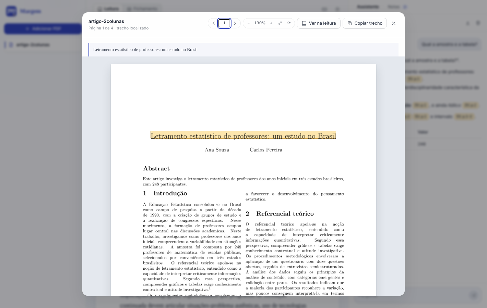
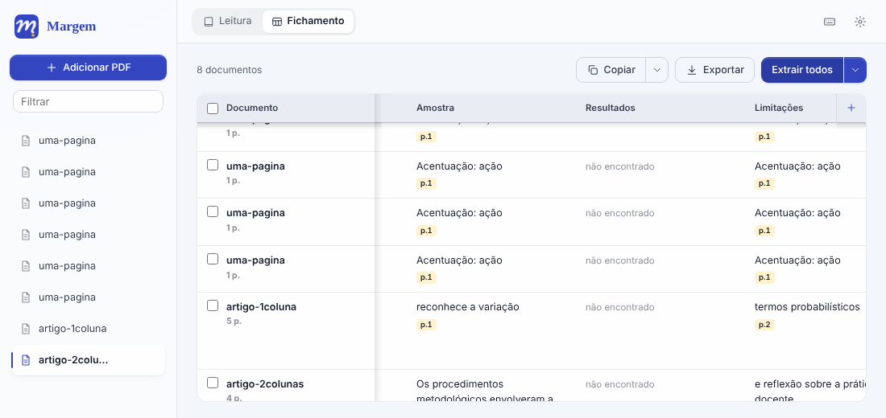
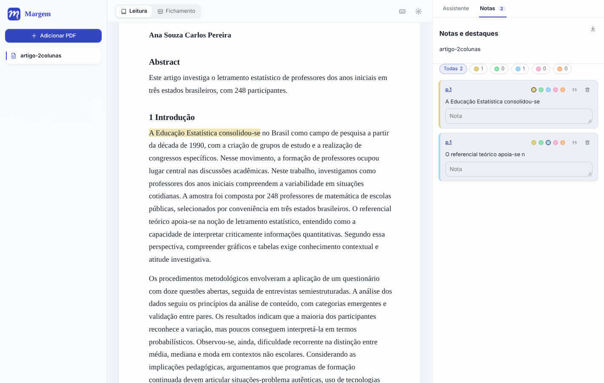
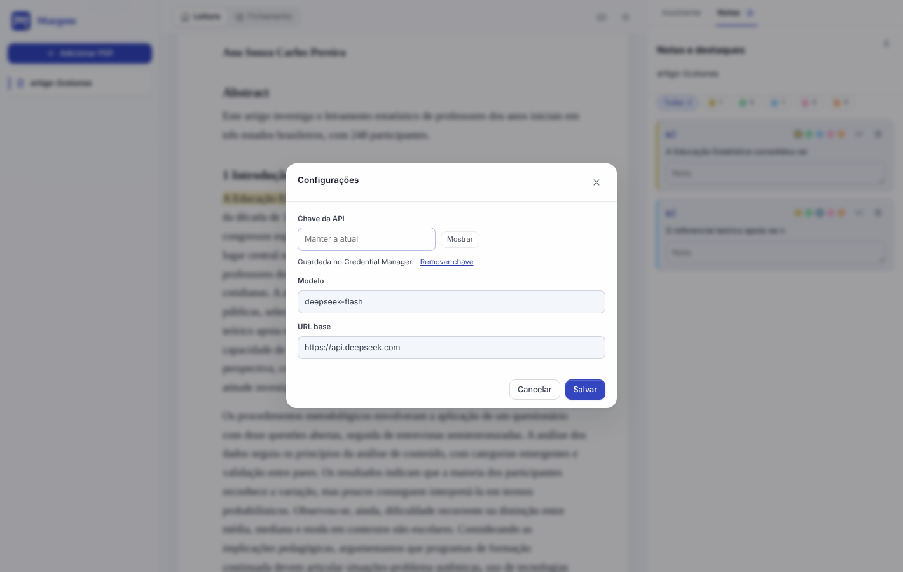

# Margem

Leitor de PDF acadêmico com chat que cita página e trecho, e quadro de fichamento preenchido por colunas. App desktop em **Tauri 2** (Rust + React), local-first, com a API da DeepSeek.


## Baixar

Instaladores na página de [Releases](https://github.com/gerlansilva/margem/releases/latest):

- **Windows**: `Margem_0.2.0_x64-setup.exe` (instalador) ou `Margem_0.2.0_x64_pt-BR.msi`.
- **macOS**: `Margem_0.2.0_universal.dmg` (Apple Silicon e Intel). Não é assinado: na primeira abertura, clique com o botão direito no app e escolha **Abrir**.

Na primeira execução, abra **Configurações** e cole a chave da DeepSeek.

A pergunta nasce na margem: você lê o artigo, anota uma dúvida ao lado do parágrafo e a resposta volta apontando de onde saiu. Clicar em `p. 7` abre o PDF na página e destaca exatamente as linhas citadas.









## O que faz

- **Importa PDF** e converte em leitura Markdown, com âncoras por página.
- **Conversa com o documento**; cada afirmação vem com `[D1 p.7]`. Clicar na citação abre a página do PDF com o trecho destacado.
- **Seleciona um trecho** na leitura e pergunta sobre ele.
- **Compara documentos**: outro PDF entra no escopo do chat (D1, D2…) e a pergunta pode comparar os dois.
- **Fichamento**: você define as colunas (nome + instrução). A IA preenche cada célula com valor, trecho literal e página; sem trecho verificado a célula fica "não encontrado".
  - **Conjunto de documentos**: marque os documentos (na barra lateral ou na tabela) e extraia as colunas só para eles, com progresso por documento e botão Cancelar. Sem seleção, vale para todos. "Só vazias e não encontradas" refaz apenas o que falta.
  - **Colunas**: o **+** no fim do cabeçalho cria uma coluna (nome e instrução), com atalhos prontos (Objetivo, Método, Amostra, Resultados, Limitações). Pelo cabeçalho dá para editar, mover, excluir e extrair só aquela coluna.
  - **Cabeçalho e coluna do documento fixos** durante a rolagem, nos dois eixos.
  - **Copiar**: tabela para colar no Excel, Word ou Docs, Markdown ou CSV, com ou sem página e trecho.
- **Renomear documentos**: duplo clique (ou F2) no título, na barra lateral; o nome vale no leitor, no chat, no fichamento e nas exportações. "Restaurar original" volta ao nome do arquivo.
- **Destaques e notas**: selecione um trecho na leitura, escolha uma de cinco cores e, se quiser, escreva uma nota. Ficam no banco local (SQLite), por documento, e saem em Markdown.
- **Busca no acervo**: procura em todos os PDFs (ou só nos selecionados), com resultados agrupados por documento, página e termos destacados. Enter ou clique abre a página no PDF com o trecho marcado. Funciona por palavras; com um endpoint de embeddings configurado, passa a achar também por significado. O rodapé mostra o modo e o andamento da indexação.
- **Relacionados (OpenAlex)**: aba ao lado de Assistente e Notas. Identifica o trabalho do documento (por vínculo salvo, DOI ou título), com Confirmar, Trocar e Desvincular, e lista relacionados, referências e citado por. Cada item abre no navegador, copia referência ou DOI e, quando o acesso aberto traz um PDF direto, **Baixar e adicionar** à biblioteca. Itens que já estão na biblioteca vêm marcados.
- **Exportações**: conversa e notas em Markdown (`.md`), fichamento em CSV com vírgula ou ponto e vírgula (UTF-8 com BOM, abre certo no Excel em português). O app abre o diálogo "Salvar" do sistema e só grava `.md`, `.txt` e `.csv`.
- **Respostas verificáveis**: se o modelo cita uma página que não foi enviada a ele, a citação aparece tracejada e com aviso. Resposta cortada pelo limite do modelo é sinalizada. Em falha de rede o chat mostra "Nova tentativa em 2 s…" antes de desistir.
- **Chave da DeepSeek no cofre do sistema** (Keychain no macOS, Credential Manager no Windows), nunca em arquivo do projeto. Em Configurações aparece onde a chave está guardada e há o botão **Remover chave**.

## Atalhos

No macOS use Cmd no lugar de Ctrl.

| Atalho | Ação |
| --- | --- |
| Ctrl+O | Adicionar PDF |
| Ctrl+F | Buscar no documento (Enter / Shift+Enter: próximo / anterior) |
| Ctrl+Shift+F | Buscar no acervo (↑ ↓ percorre, Enter abre, Esc fecha) |
| Ctrl+K | Perguntar ao assistente |
| Ctrl+1 / Ctrl+2 | Leitura / Fichamento |
| Ctrl+, | Configurações |
| Ctrl+/ | Ver atalhos |
| Ctrl+Enter | Salvar a nota |
| Esc | Parar a resposta; fechar janelas |

## Como funciona

1. **Extração** (`src/pdf.js`): o pdf.js entrega os itens de texto com posição e tamanho de fonte. O app agrupa em linhas, detecta colunas, remonta parágrafos, reconstrui tabelas em Markdown e guarda, por página, os blocos (para o leitor) e as linhas com o retângulo no espaço do PDF.
2. **Contexto** (`src-tauri/src/ai.rs`): a pergunta escolhe as páginas por raridade de termo (IDF), o documento vai com marcadores `[p. 7]` e a resposta é instruída a citar página e trecho literal.
3. **Citação** (`src-tauri/src/evidence.rs`): `resolve_evidence` acha a menor sequência contígua de linhas que contém o trecho e devolve um retângulo por linha. O modal abre o PDF no zoom escolhido e desenha o destaque pela matriz do viewport — sobrevive a zoom, rotação e redimensionamento.

## Instalar e rodar

Pré-requisitos: Node 20+, Rust 1.77+ e, no macOS, Xcode Command Line Tools.

```sh
npm install
npm run app
```

Na primeira execução, abra **Configurações** (engrenagem) e cole a chave da DeepSeek. Também é possível usar a variável `DEEPSEEK_API_KEY` (ela tem prioridade e não pode ser removida pelo app).

Modelo padrão: `deepseek-flash`. A base URL e o modelo são configuráveis, então qualquer endpoint compatível com OpenAI funciona.

Build de produção local (gera o instalador do sistema em que você está):

```sh
npm run tauri build
```

### Instaladores para Windows e macOS

O workflow `.github/workflows/build.yml` (GitHub Actions) roda em push na `main`, em pull request e manualmente. Ele faz o build da interface, roda `cargo test` e `clippy` no macOS e no Windows e gera os instaladores:

- **Windows**: `.exe` (NSIS, instala só para o usuário) e `.msi`.
- **macOS**: `.dmg` universal (Apple Silicon e Intel).

A cada push na `main` o workflow cria (ou atualiza) o release `v<versão>`, a versão vem de `src-tauri/tauri.conf.json`, e anexa os instaladores. Para lançar uma versão nova, aumente o número em `package.json`, `src-tauri/Cargo.toml` e `src-tauri/tauri.conf.json` e envie para a `main`. Os arquivos também ficam como artefatos da execução por 14 dias.

**Aviso: os builds para Mac não são assinados nem notarizados.** Na primeira abertura o macOS bloqueia o app: arraste o Margem para Aplicativos, clique com o botão direito, escolha **Abrir** e confirme (ou, em Ajustes do Sistema > Privacidade e Segurança, **Abrir mesmo assim**). No Windows, o SmartScreen também pode avisar que o editor é desconhecido (**Mais informações > Executar assim mesmo**).

## Custo por pergunta

A pergunta não manda o artigo inteiro. O app escolhe as páginas por peso de termo (um termo raro, como "sobrenome" ou "BLEU", vale mais que "artigo", que aparece em todas), sempre inclui a página 1 e a página seguinte das duas melhores, e para no teto de 18 mil caracteres — cerca de 4 a 5 mil tokens. Antes isso tudo ia junto e dava 11 a 12 mil tokens por pergunta.

A extração do fichamento é a exceção: precisa ver o documento todo para achar números, então vai inteira (uma vez, quando você clica em Extrair).

O histórico volta só com as últimas seis mensagens, para uma resposta longa antiga não ser reenviada a cada pergunta. O cache de contexto da DeepSeek funciona enquanto o começo do prompt não muda.

## Onde ficam os dados

- **Windows**: `%LOCALAPPDATA%\br.com.gerlan.pdfchat\` (normalmente `C:\Users\<você>\AppData\Local\br.com.gerlan.pdfchat`)
- **macOS**: `~/Library/Application Support/br.com.gerlan.pdfchat/`

Dentro dela:

- Banco (documentos, páginas, fichamento, destaques e notas): `pdfchat.sqlite3`
- PDFs importados: `uploads/`
- Figuras recortadas: `figures/<doc>/<página>-<n>.png`

A chave da API **não** fica no banco: vai para o Keychain (macOS) ou o Credential Manager (Windows). Chaves que versões antigas guardavam no SQLite são movidas para o cofre automaticamente na primeira abertura; só se o cofre do sistema não estiver disponível a chave cai de volta para o banco, e as Configurações avisam. Os destaques da versão 0.1 (que ficavam no armazenamento do navegador embutido) são migrados para o banco uma única vez, ao abrir o documento.

Em **Configurações**: a seção **Busca por significado (opcional)** recebe a URL, o modelo e a chave de um endpoint de embeddings compatível com OpenAI (por exemplo Ollama: `http://localhost:11434/v1` e `nomic-embed-text`); **Reindexar** reconstrói o índice. O campo **E-mail** do OpenAlex identifica o app nas consultas (pool educado, opcional).

Para apagar tudo, feche o app e remova essa pasta (e a chave, em Configurações > Remover chave).

## Identidade

Nome de trabalho: **Margem** — a pergunta anotada ao lado do parágrafo. O "m" manuscrito fecha numa interrogação e o ponto âmbar é a anotação à margem.

| Cor | HEX | Onde |
| --- | --- | --- |
| Índigo | `#3346C0` | marca (fundo do logo), aba ativa, botões (texto branco), traço lateral do trecho citado |
| Papel | `#F3F6FB` | fundo ao redor do documento |
| Branco | `#FFFFFF` | página do artigo, painel do assistente, células |
| Tinta | `#181E2C` | texto do artigo, perguntas e respostas |
| Âmbar | `#BD871C` | destaque da evidência no PDF (o ponto do logo é `#EDB333`) |
| Âmbar claro | `#FFF2CF` | fundo do destaque e etiquetas `p. 1` / `p. 7` |

A paleta é única e clara (o app não tem tema escuro; o PDF também fica sempre claro). Tudo sai de `src/styles.css` (`:root`): `--accent`, `--canvas`, `--ink`, `--evidence`, `--evidence-soft`. O site deve usar os mesmos valores — índigo nas ações, âmbar nas evidências — para que a etiqueta `p. 7` do fichamento e o traço no PDF sejam reconhecidos como a mesma marca.

O identificador do aplicativo continua `br.com.gerlan.pdfchat`: mudá-lo mudaria a pasta de dados e a biblioteca existente ficaria para trás.

## Cabeçalho e rodapé

O texto que a IA lê não inclui o aparato da página:

- **Cabeçalho de periódico** no alto (ISSN, DOI, "Revista X, v. 3, n. 4") sai em qualquer página, mesmo que apareça uma vez só.
- **Cabeçalho/rodapé repetido** (título abreviado, nome do autor, "VIDYA 2") sai quando aparece em pelo menos 40% das páginas, com mínimo de duas. A conta é feita por **linha**, antes de virar parágrafo: na primeira página o cabeçalho costuma vir colado na chamada de nota e, agrupado, deixaria de casar com as outras páginas.
- **Nota de rodapé** na metade de baixo sai a partir do marcador que inicia a nota — "1 Recebido em:", "Aprovado em", "∗ Equal contribution" — até o pé da página. Também sai a nota numerada escrita em **corpo menor** que o texto ("2 Em Santos (2015), foram elencadas 9 categorias…"), que é o formato mais comum em revista brasileira.
- Os **números de chamada** dessas notas saem junto, inclusive no meio do parágrafo ("… universidades brasileiras 1. O critério…"), mas só quando existe nota com aquele número na página.
- Número de página solto já era descartado.

Tabelas e referências não entram nesse corte: a nota só é removida quando começa por um marcador de nota, pela fórmula "Recebido em" ou por um número em corpo menor seguido de texto pequeno.

## Rastreabilidade da citação

Cada página guarda duas coisas além do Markdown: os blocos (para o leitor) e as **linhas** com o texto e o retângulo no espaço do PDF (`[x0, y0, x1, y1]`, origem embaixo à esquerda). O retângulo é o que sobrevive a zoom, rotação e redimensionamento: o destaque é recalculado a cada renderização com a matriz do viewport, nunca com pixels fixos.

- `resolve_evidence(doc, página, citação)` acha a menor sequência contígua de linhas que contém a citação. Se o texto exato não casa — a IA às vezes troca uma flexão, "coligiu" por "coligidas" —, cai num alinhamento por palavras que exige 70% delas na ordem e um vão curto de linhas. Citação inventada continua sem destaque.
- O id (`doc:página:primeira-última`) é gravado na tabela `evidence`. O fichamento guarda os ids em `cells.evidence`; ao clicar na célula, o modal abre o PDF na página, desenha o destaque em âmbar e centraliza o trecho. Sem id, o modal resolve a citação na hora; se não achar, avisa "trecho não localizado" e não destaca nada.
- Página de duas colunas é lida por faixas: o que atravessa a página fecha a faixa, e dentro dela a coluna esquerda vem antes da direita. Sem isso, uma frase que muda de coluna era montada com pedaços de linhas diferentes.

## Estrutura

```
src/                 React
  pdf.js             extração pdf.js + montagem de páginas/blocos/linhas
  components/        leitor, chat, fichamento, modal de origem, logo
src-tauri/src/
  lib.rs             comandos Tauri (importar, chat, extrair, destaques, exportar)
  ai.rs              prompts, contexto com marcadores de página, validação de quotes
  evidence.rs        citação -> sequência de linhas + retângulos de destaque
  db.rs              SQLite (rusqlite), com migração de bancos antigos
  export.rs          CSV (vírgula ou ponto e vírgula, BOM)
  files.rs           caminhos seguros e gravação de .md/.txt/.csv
  secrets.rs         chave da API no cofre do sistema (keystore.rs)
  model.rs           tipos compartilhados
src-tauri/icons/     ícone do app (gerado com `npx tauri icon` a partir de um PNG 1024 do logo)
```

## Testes

```sh
npm test                      # vitest: citações, CSV, exportação, anotações, api.js
npm run build                 # o build da interface também precisa passar
cd src-tauri && cargo test --lib
cargo clippy --lib --tests    # dentro de src-tauri
```

Para ver a interface inteira no navegador, sem o Rust, use o backend simulado (`src/dev/tauri-mock.js`):

```sh
npm run mock                  # abre em http://localhost:1420
node src/dev/e2e/flows.mjs    # roteiros Playwright contra o mock (também: more, full, cite, integr)
```

Os roteiros usam o Chrome do sistema (`CHROME=/caminho/chrome`) e PDFs de teste em `MARGEM_FIXTURES` (padrão `/tmp/margem-fixtures`). O mock não substitui o teste no app real: Keychain, Credential Manager, diálogos nativos e arrastar-e-soltar só se verificam no Tauri.

Os testes Rust cobrem o banco (inclusive a migração de bancos da 0.1 e os destaques), a gravação de arquivos, o CSV com os dois delimitadores, a resolução de citação (linha única, duas linhas, hífen quebrado, palavra flexionada pela IA, citação inexistente) e a montagem do contexto do chat (seleção de páginas por pergunta, pergunta genérica, histórico curto).

Casos verificados no app com artigos reais:

- Artigo de duas colunas, citação de duas linhas destacada a 130% e 200%.
- Referência citada numa célula do fichamento abrindo a página certa e destacando só aquelas linhas.
- Tabela de quatro colunas reconstruída em Markdown; figura enviada ao modelo por visão.
- Nota de rodapé e biografia de autores fora da leitura, do chat e das citações; chamador no meio do parágrafo também sai.

## Limitações e próximos passos

- PDF escaneado sem camada de texto não é lido. O próximo passo é OCR (ou a API de OCR da DeepSeek).
- Tabela que continua na página seguinte pode sair partida; o recorte visual cobre a maior parte dos casos.
- Tabela de largura total em página de duas colunas pode degradar para texto.
- Referências de duas colunas podem perder a continuação de uma entrada longa.
- Fichamento manual: a célula ainda não é editável na interface; a extração é sempre pela IA.
- Builds sem assinatura (veja acima); atualização automática ainda não existe.
- Ainda não há busca full-text na biblioteca.
- Uma pergunta cujo assunto não aparece em nenhuma página selecionada pode receber "não encontrado". Citar a seção ("nas considerações finais…") resolve.
